# Heart Disease Risk Prediction - MLOps Assignment 1 Report

**Course:** Machine Learning Operations (MLOps) AIMLCZG523
**Student:** Ritabrata Chakraborty | **Student ID:** 2025AE05627
**Date:** 16 October 2026

| | |
|---|---|
| **Code repository** | https://github.com/rambo3300/heart-disease-mlops |
| **Demo video** | https://drive.google.com/file/d/1-80kzyCzpoHcGA86AKi0jVrkBiBsvfLR/view?usp=drive_link |
| **Deployed API (local Kubernetes)** | `http://localhost:8080/predict` - access instructions in Section 9 |

---

## 1. Introduction

The goal of this project is a classifier that predicts the presence of heart disease from patient health data, delivered as a reproducible, tested, containerised and monitored API. The work covers the full MLOps lifecycle: data acquisition, EDA, model development, experiment tracking, packaging, CI/CD, containerisation, Kubernetes deployment and monitoring. Everything runs on a local machine; no cloud subscription was used.

**Tech stack:** Python 3.11, pandas, scikit-learn 1.5.2, MLflow, FastAPI, Docker Desktop, Kubernetes (Docker Desktop), Prometheus, Grafana, GitHub Actions, pytest, flake8.

## 2. Setup and installation

```bash
git clone https://github.com/rambo3300/heart-disease-mlops
cd heart-disease-mlops
python -m venv .venv
.venv\Scripts\Activate.ps1          # Windows PowerShell (Linux/macOS: source .venv/bin/activate)
pip install -r requirements.txt
python scripts/download_data.py     # download + clean data
python -m src.eda                   # EDA figures
python -m pytest                    # unit tests
python -m src.train                 # train, tune, track in MLflow, save model
```

Docker, Kubernetes and monitoring commands are in the repository README (Sections 7-9). Python 3.11 is recommended because the dependency versions are pinned.

## 3. Data acquisition and EDA

**Dataset:** UCI Heart Disease, Cleveland subset: 303 patients, 13 predictors and one target. `scripts/download_data.py` downloads `processed.cleveland.data` from the UCI repository (with a zip-archive fallback and a `--from-file` option for offline use) and writes `data/raw/heart_disease_raw.csv` and `data/processed/heart_disease_clean.csv`.

| Feature | Description |
|---|---|
| age, sex | Age in years; sex (1 = male) |
| cp | Chest pain type (1-4) |
| trestbps, chol | Resting blood pressure (mm Hg); serum cholesterol (mg/dl) |
| fbs | Fasting blood sugar > 120 mg/dl |
| restecg | Resting ECG result (0-2) |
| thalach | Maximum heart rate achieved |
| exang | Exercise induced angina |
| oldpeak, slope | ST depression induced by exercise; slope of the peak exercise ST segment |
| ca | Number of major vessels (0-3) coloured by fluoroscopy |
| thal | Thalassemia (3 = normal, 6 = fixed defect, 7 = reversible defect) |
| target | Original severity 0-4, binarised: 0 = no disease, 1 = disease |

### 3.1 Data cleaning

* The raw file has **303 rows and 0 duplicate rows**.
* Missing values are marked with `?` in the source. After conversion to NaN there are **6 missing values in total: `ca` (4) and `thal` (2)**; every other column is complete.
* The target was binarised (severity 1-4 becomes 1), giving 164 patients without disease and 139 with disease.
* Missing values were imputed with the median (numeric) or mode (categorical) in the stored clean CSV, so no rows were lost (303 rows before and after). The model pipeline additionally contains imputers fitted on training folds only, so inference is robust to missing values and cross-validation does not leak validation statistics.

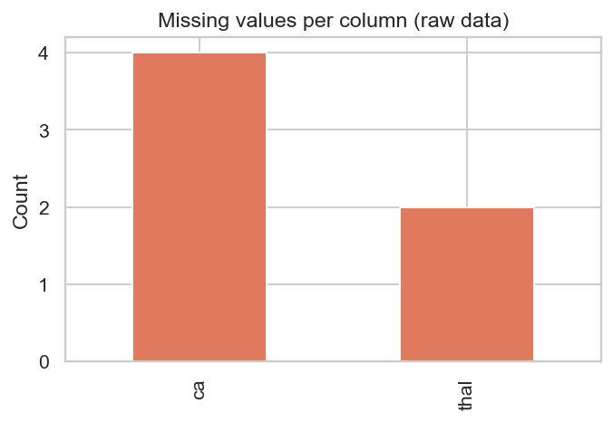

### 3.2 Class balance

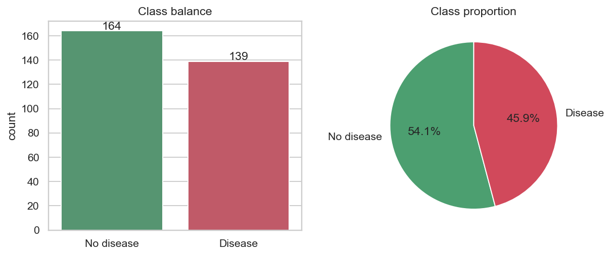

The classes are close to balanced: **54.1 % no disease (164) versus 45.9 % disease (139)**. Accuracy is therefore a meaningful metric and no resampling was needed. Recall is still tracked closely, because missing a sick patient is clinically costlier than a false alarm.

### 3.3 Summary statistics

| Feature | Mean | Std | Min | Max |
|---|---|---|---|---|
| age | 54.44 | 9.04 | 29 | 77 |
| trestbps | 131.69 | 17.60 | 94 | 200 |
| chol | 246.69 | 51.78 | 126 | 564 |
| thalach | 149.61 | 22.88 | 71 | 202 |
| oldpeak | 1.04 | 1.16 | 0.0 | 6.2 |
| ca | 0.66 | 0.93 | 0 | 3 |

About 68 % of patients are male (mean of `sex` = 0.68), and 15 % have fasting blood sugar above 120 mg/dl.

### 3.4 Distributions and correlations

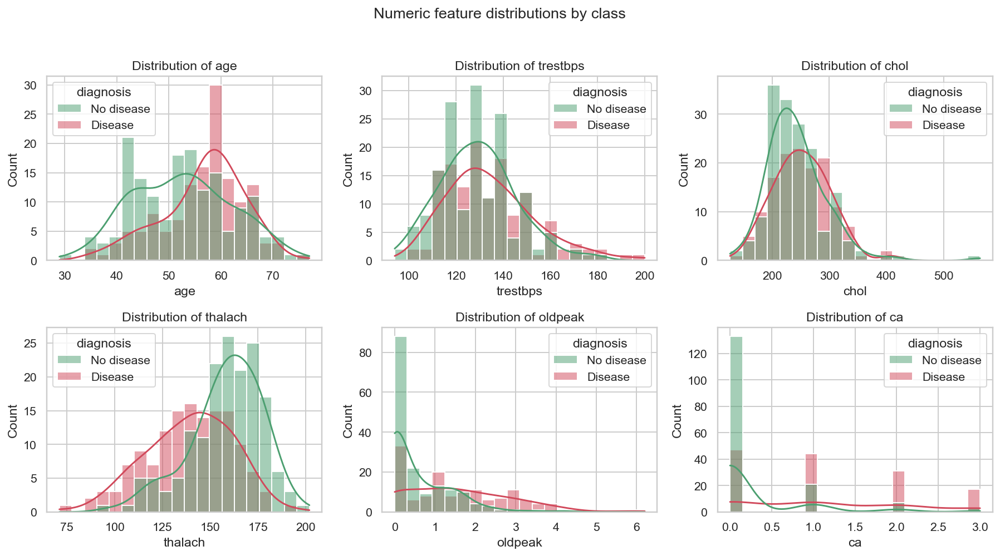

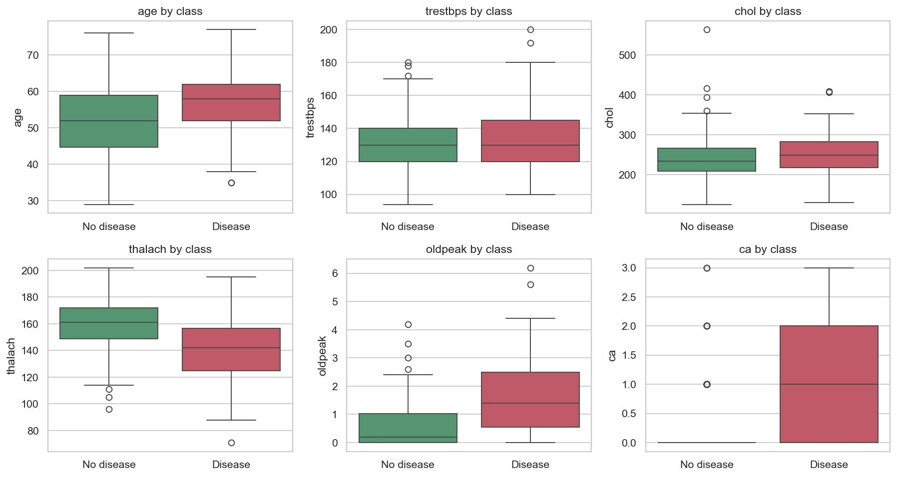

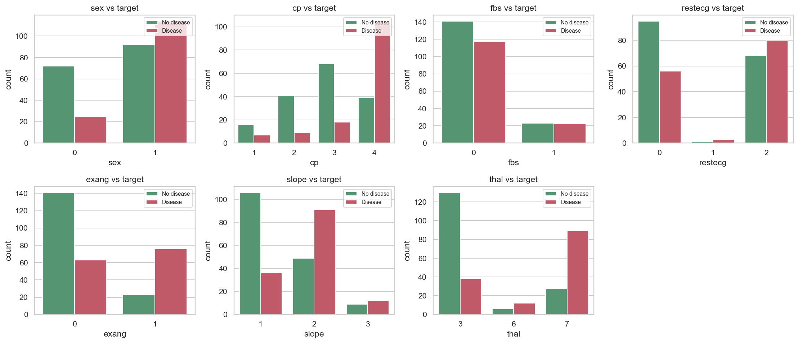

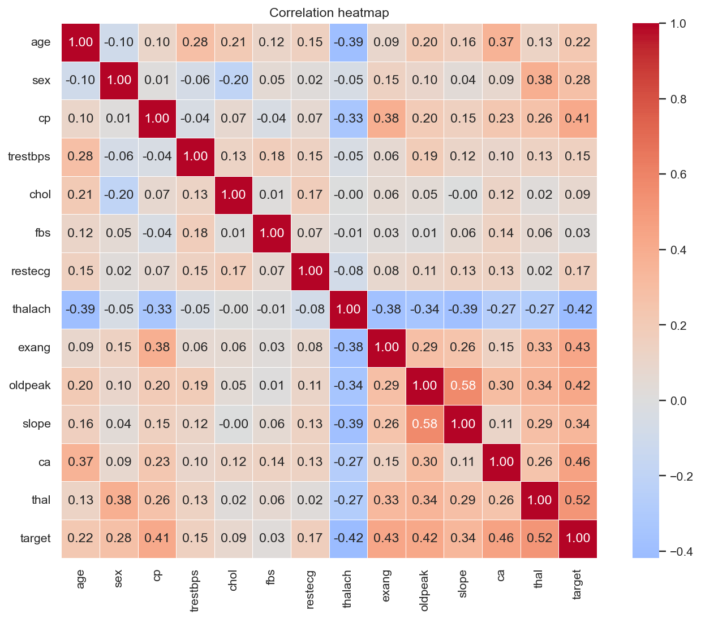

**Observations**

* **Maximum heart rate (`thalach`)**: patients with disease have clearly lower values (their distribution peaks around 145 bpm, versus roughly 160-175 bpm for healthy patients). Correlation with the target is -0.42.
* **`oldpeak` and `ca`**: healthy patients are concentrated at 0, whereas patients with disease are spread towards higher ST depression and 1-3 blocked vessels. `ca` (0.46) and `oldpeak` (0.42) are both strongly associated with the target.
* **Strongest single correlations with the target:** `thal` (0.52), `ca` (0.46), `exang` (0.43), `oldpeak` (0.42), `thalach` (-0.42) and `cp` (0.41). `fbs` (0.03) and `chol` (0.09) are almost uninformative on their own.
* **Age**: the disease group peaks at roughly 58-60 years, whereas the healthy group has an additional cluster around 42; the correlation with the target is modest (0.22).
* **Collinearity:** the highest correlation between predictors is `oldpeak` and `slope` (0.58); the rest are below 0.4 in absolute value (for example `age` and `thalach` at -0.39, `sex` and `thal` at 0.38). No feature pair is redundant enough to require removal, and regularisation in the models further limits any effect.
* **Outliers:** `chol` has one extreme value (564 mg/dl) and `trestbps` a small right tail up to 200 mm Hg. These are plausible clinical values, so they were kept; standard scaling and regularised or tree-based models handle them acceptably.

## 4. Feature engineering and modelling

### 4.1 Preprocessing pipeline

A single `ColumnTransformer` (`src/features.py`) is part of the model `Pipeline`:

* **Numeric** (age, trestbps, chol, thalach, oldpeak, ca): median imputation, then `StandardScaler`.
* **Categorical** (sex, cp, fbs, restecg, exang, slope, thal): most-frequent imputation, then `OneHotEncoder(handle_unknown="ignore")`.

Because preprocessing lives inside the pipeline, cross-validation never leaks validation-fold statistics, and exactly the same transformations are applied at inference time. The saved model accepts raw feature values.

### 4.2 Models, tuning and evaluation protocol

| Model | Rationale | Hyper-parameters searched |
|---|---|---|
| Logistic Regression | Interpretable, strong baseline for small tabular data | `C` (0.01 to 100), `class_weight` |
| Random Forest | Captures non-linear interactions, robust to scale | `n_estimators`, `max_depth`, `min_samples_leaf` |
| Gradient Boosting | Often the strongest option on tabular data | `n_estimators`, `learning_rate`, `max_depth` |

* Stratified 80/20 split with `random_state=42`: **242 training rows and 61 test rows**. The test set was not touched until the final evaluation.
* `GridSearchCV` with 5-fold `StratifiedKFold`, refitting on **ROC-AUC**; accuracy, precision, recall and F1 were tracked as well.
* **Model selection uses CV ROC-AUC only**, never the test set. Cross-validated scores of the winning configuration are slightly optimistic because the same folds picked the hyper-parameters; the hold-out test set provides the independent estimate.

### 4.3 Results

| Model | CV acc | CV prec | CV recall | CV F1 | CV ROC-AUC | Test acc | Test prec | Test recall | Test F1 | Test ROC-AUC |
|---|---|---|---|---|---|---|---|---|---|---|
| **logistic_regression** | **0.8511** | **0.8776** | **0.7921** | **0.8299** | **0.9113** | 0.8852 | 0.8387 | 0.9286 | 0.8814 | **0.9610** |
| random_forest | 0.8098 | 0.8194 | 0.7557 | 0.7821 | 0.8996 | 0.8852 | 0.8387 | 0.9286 | 0.8814 | 0.9481 |
| gradient_boosting | 0.8179 | 0.8290 | 0.7735 | 0.7938 | 0.8840 | 0.8852 | 0.8621 | 0.8929 | 0.8772 | 0.9448 |

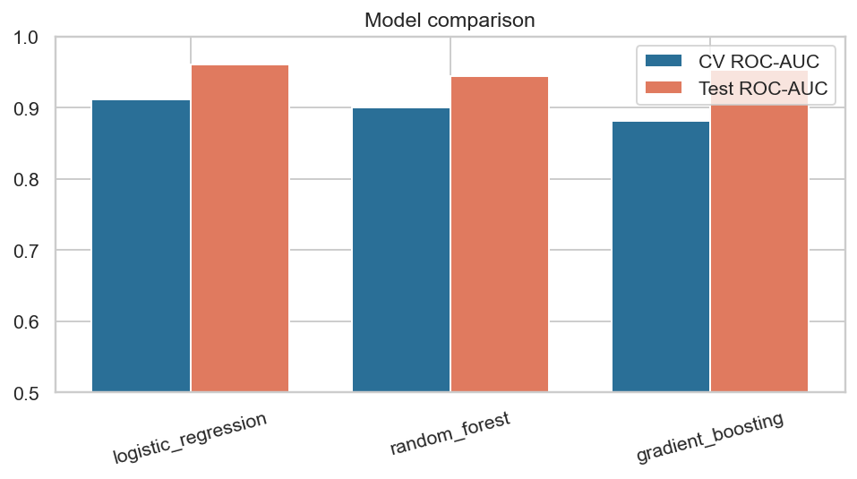

**Selected model: Logistic Regression** (`C = 0.1`, `class_weight = None`). It has the best cross-validated score on every metric and the best ROC-AUC on the test set as well (0.961).

**Test-set behaviour of the selected model** (61 patients):

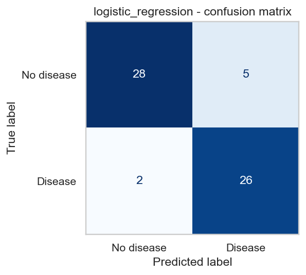

* Confusion matrix: 28 true negatives, 5 false positives, 2 false negatives, 26 true positives.
* **Recall 92.9 %** (26 of 28 sick patients detected) and **precision 83.9 %** (26 of 31 positive predictions correct). In a screening setting the two missed patients matter more than the five false alarms, so this trade-off is acceptable.

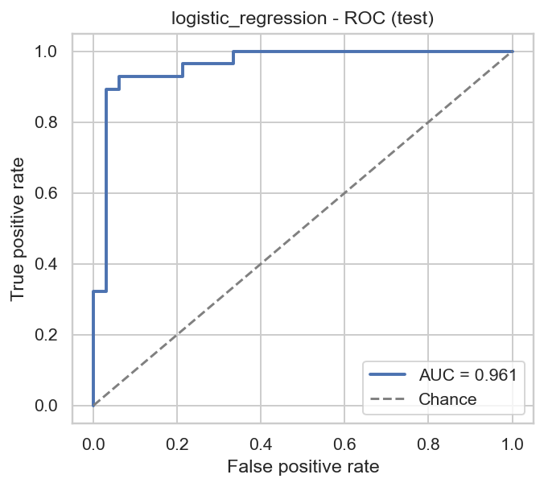

The ROC curve rises steeply: roughly 89 % true-positive rate is reached at under 5 % false-positive rate, and AUC is 0.961.

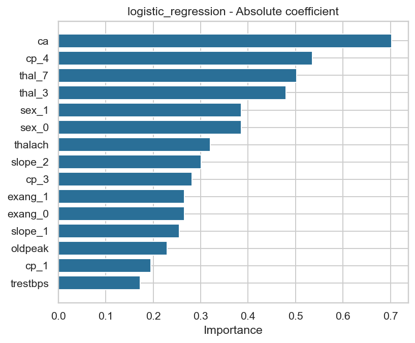

The chart shows absolute coefficient magnitudes, so it ranks strength but not direction. The most influential inputs are `ca`, chest-pain type 4 (`cp_4`) and the thalassemia categories (`thal_7`, `thal_3`), followed by `sex`, `thalach` and `slope`. This agrees with the EDA, where `ca`, `thal`, `cp` and `thalach` showed the strongest relationship with the target. (`sex_0` and `sex_1` have identical magnitudes because they are the two mirror-image columns of one binary variable.)

**Interpretation and caveats**

* The differences between models are small. Logistic Regression leads by about 0.012 ROC-AUC over Random Forest in cross-validation, and all three models reach the same test accuracy (88.5 %). Given that near-tie, the simplest and most interpretable model is the sensible production choice.
* **Test scores are higher than CV scores for all three models** (for example test recall 0.93 versus CV recall 0.79 for the selected model). The test set has only 61 patients, so one patient changes accuracy by about 1.6 percentage points; the CV estimates (computed on 242 patients, five folds) are the more conservative and more reliable indicator of expected performance, and the true performance is probably closer to them.
* The dataset is small (303 patients) and comes from a single hospital, so generalisation to other populations is untested. This is a learning project, not a medical device.

## 5. Experiment tracking (MLflow)

Every training run logs to a local SQLite-backed MLflow store (`mlflow.db`, artifacts under `mlruns/`). A parent run called `training-session` records the dataset sizes, CV settings, git commit and selected model; each model has a nested run containing:

* **Parameters:** best hyper-parameters and the size of the search space.
* **Metrics:** `cv_<metric>_mean`, `cv_<metric>_std` and `test_<metric>` for accuracy, precision, recall, F1 and ROC-AUC.
* **Artifacts:** confusion matrix, ROC curve, feature-importance plot, `cv_results.csv`, a classification report and the sklearn model with its signature and input example.

The final run id (`f1ddcdb6f8f34fdda22a6f3433cd3041`) is stored in `models/model_metadata.json`, linking the deployed model back to its experiment.

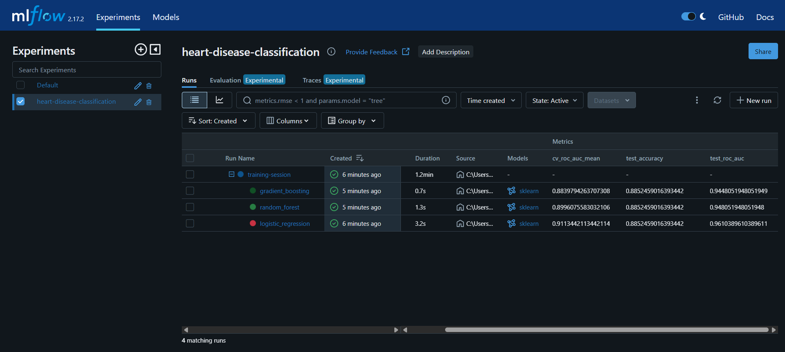

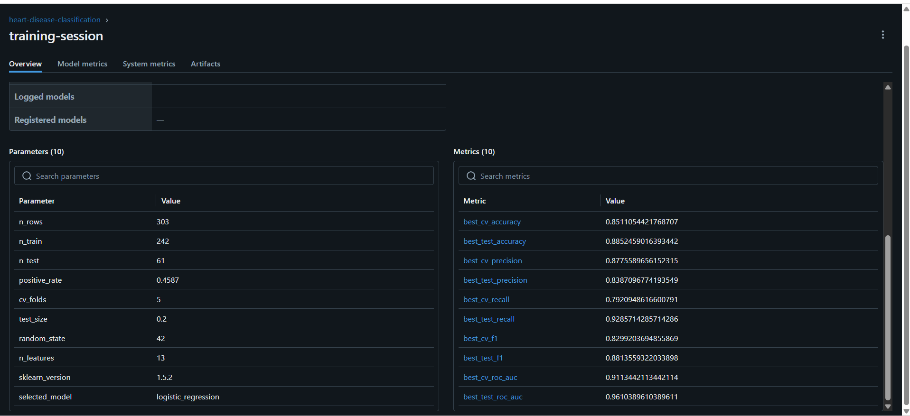

**What the runs showed:** the grid search for Logistic Regression preferred moderate regularisation (`C = 0.1`) with no class weighting, which fits the near-balanced classes. The tree ensembles did not beat the linear model, which suggests that the signal in this small dataset is largely linear and additional model flexibility mainly adds variance.

## 6. Model packaging and reproducibility

* `models/model.joblib` is the full sklearn `Pipeline` (preprocessing plus estimator). `models/model_metadata.json` stores the model name, version (`20261010161647`), feature list, best parameters, CV and test metrics, scikit-learn version (1.5.2) and the MLflow run id. The model is also stored in MLflow format in each run's `model/` artifact.
* `requirements.txt` (full environment) and `requirements-api.txt` (serving) pin exact versions. The **same scikit-learn version is used for training and serving**, avoiding pickle incompatibilities.
* Random seeds are fixed (`random_state=42`), and a unit test asserts that two training runs produce identical metrics.

## 7. Testing and CI/CD

**Unit tests** (`tests/`, pytest) cover data cleaning (target binarisation, missing values, `?` markers, duplicate removal, schema validation), preprocessing (finite output, scaling, unseen categories), model training (artifacts, metric ranges, reproducibility, prediction from raw input), the API (health, predict, validation errors, batch, metrics endpoint, HTTP 503 without a model) and MLflow logging. Tests use synthetic data so the pipeline needs no network access. Result: **29 tests passed**.

**GitHub Actions** (`.github/workflows/ci.yml`) runs on every push and pull request with four dependent jobs: **lint (flake8) -> unit tests with coverage -> data download, EDA and training -> Docker build and smoke test**. A failure in any step stops the pipeline, and every job uploads artifacts (test and coverage reports, training log, MLflow runs, model, figures, container logs). The pipeline completed successfully (all jobs green).

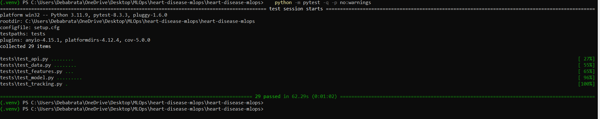

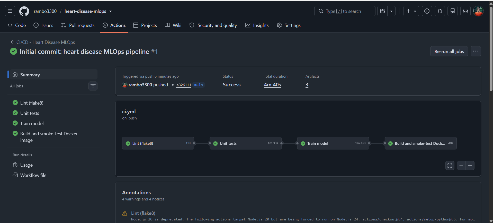

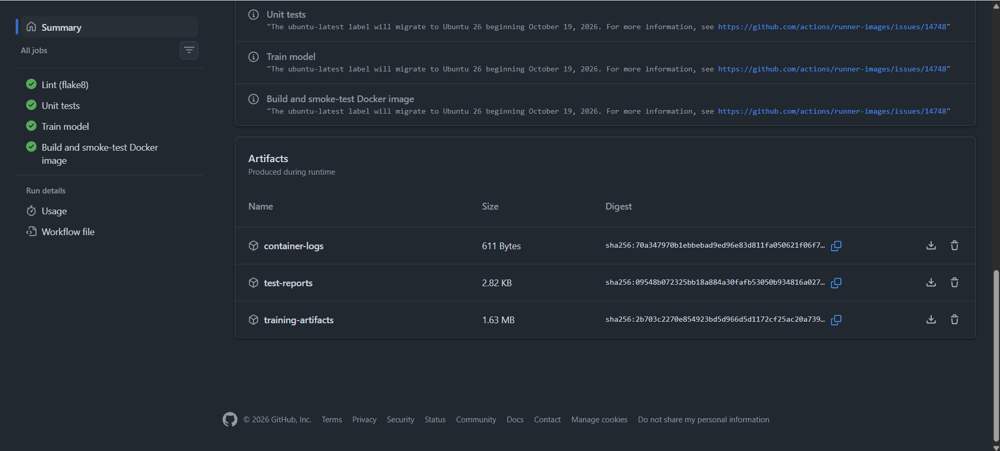

## 8. Containerisation

The `Dockerfile` uses `python:3.11-slim`, installs only the serving dependencies, runs as a non-root user and defines a health check; the app is served with Uvicorn. Endpoints:

| Endpoint | Purpose |
|---|---|
| `POST /predict` | JSON patient record in, prediction and confidence out |
| `POST /predict/batch` | List of patients in, list of predictions out |
| `GET /health` | Liveness / readiness (HTTP 503 if the model is not loaded) |
| `GET /model-info` | Model metadata |
| `GET /metrics` | Prometheus metrics |

Inputs are validated with pydantic (types and clinical ranges); invalid input returns HTTP 422.

```bash
docker build -t heart-disease-api:1.0.0 .
docker run -d --name heart-api -p 8000:8000 heart-disease-api:1.0.0
python scripts/smoke_test.py http://localhost:8000
```

Example request and response (the first patient of the dataset, whose true label is "no disease"):

```json
{"age": 63, "sex": 1, "cp": 1, "trestbps": 145, "chol": 233, "fbs": 1, "restecg": 2,
 "thalach": 150, "exang": 0, "oldpeak": 2.3, "slope": 3, "ca": 0, "thal": 6}
```
```json
{"prediction": 0, "label": "no heart disease", "confidence": 0.6191,
 "probability_disease": 0.3809, "model_name": "logistic_regression",
 "model_version": "20261010161647"}
```

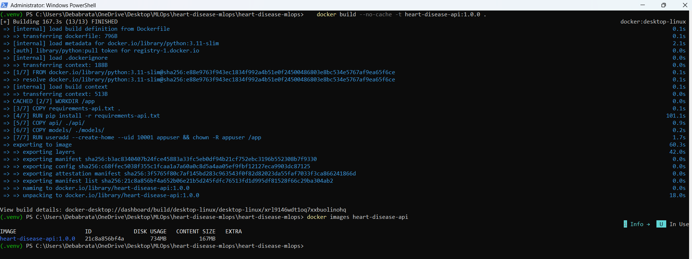

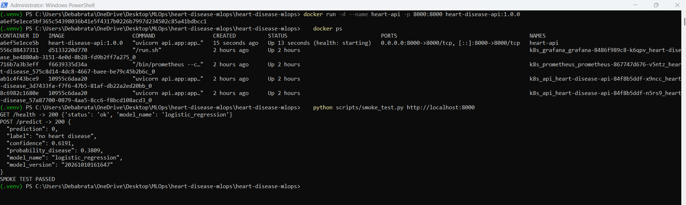

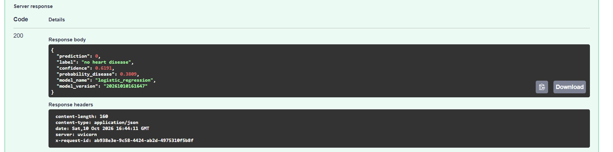

## 9. Production-style deployment (local Kubernetes)

No cloud subscription was used. The image was deployed to the local Kubernetes cluster built into **Docker Desktop**.

| Manifest | Purpose |
|---|---|
| `k8s/deployment.yaml` | 2 replicas, rolling updates (`maxUnavailable: 0`), readiness and liveness probes, CPU/memory requests and limits, Prometheus scrape annotations |
| `k8s/service.yaml` | `LoadBalancer` Service exposing port 8080 |
| `k8s/ingress.yaml` | Optional NGINX Ingress (`heart.local`) |
| `k8s/hpa.yaml` | Optional CPU-based autoscaling |
| `k8s/monitoring/*.yaml` | Prometheus (pod discovery plus RBAC) and Grafana |

```bash
bash scripts/k8s_deploy.sh        # or run the kubectl commands from the script one by one
python scripts/smoke_test.py http://localhost:8080
```

**Access instructions:** API documentation at `http://localhost:8080/docs`, predictions at `POST http://localhost:8080/predict`, Grafana at `http://localhost:3000` (admin / admin). Clean-up: `kubectl delete namespace heart-disease`.

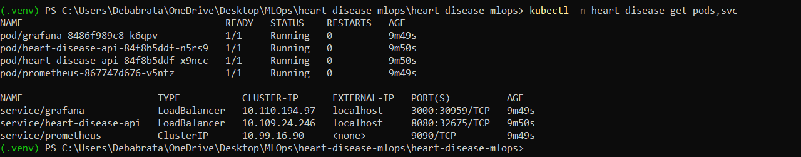

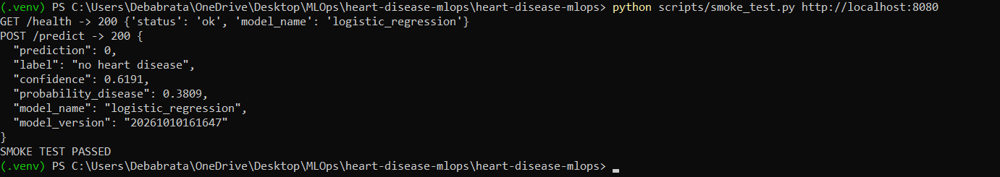

## 10. Monitoring and logging

* **Logging:** every request produces a structured JSON log line (request id, method, path, status code, latency, client). Model-load events and errors are logged too, and everything is visible through `docker logs` and `kubectl logs`.
* **Metrics** exposed at `/metrics` in Prometheus format: `api_requests_total{method,endpoint,status}`, `api_request_latency_seconds` (histogram), `model_predictions_total{label}`, `model_prediction_confidence` (histogram), `api_requests_in_progress` and `model_loaded`.
* **Prometheus** discovers the API pods through Kubernetes annotations, and **Grafana** displays a provisioned dashboard with request rate, p95 latency, responses by status code, predictions per class, median confidence and the number of healthy instances.
* `scripts/generate_traffic.py` sends random requests (including a few invalid ones) so the dashboard shows live data, including 4xx responses.

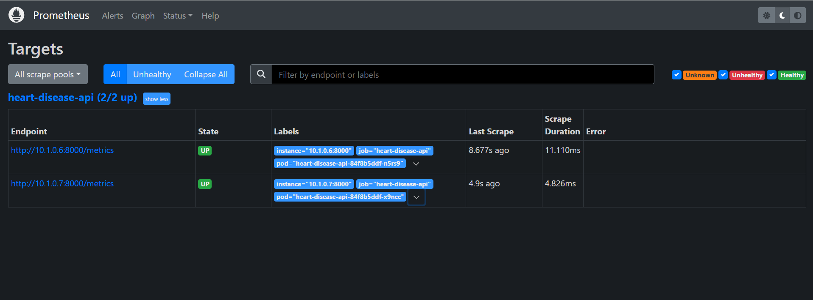

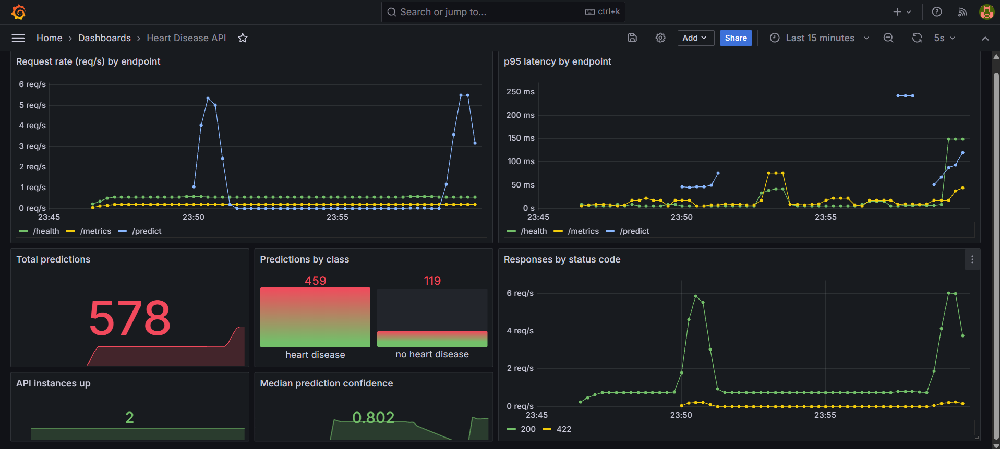

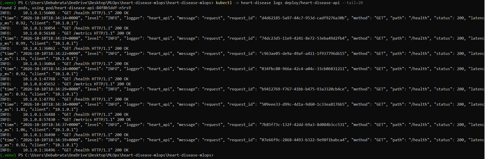

## 11. Architecture

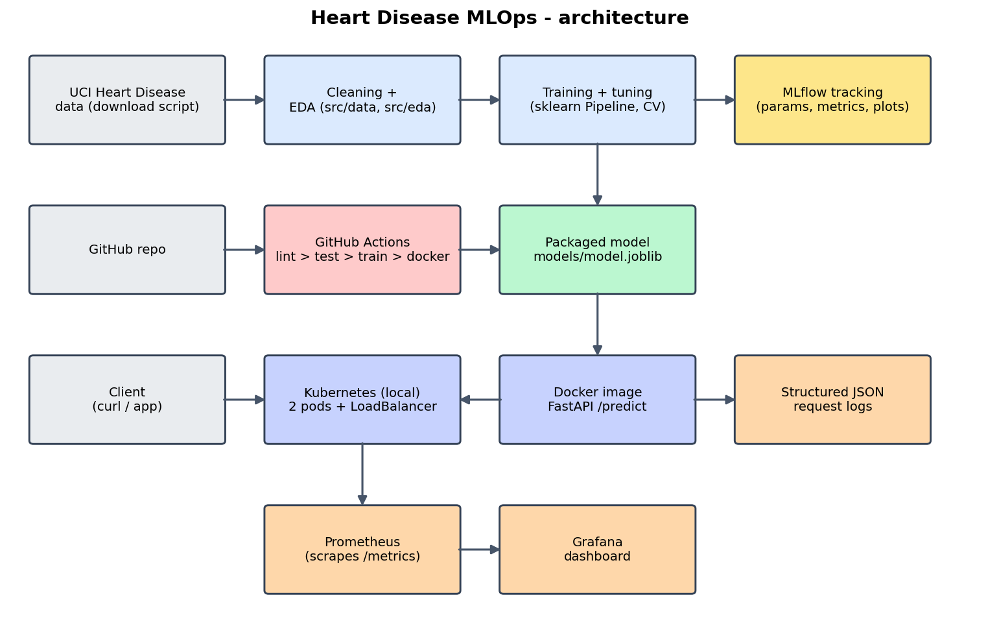

Data flows from the UCI download script through cleaning and EDA into training; MLflow records every run and the best model is packaged as `model.joblib`. GitHub Actions lints, tests, retrains and smoke-tests the container on every push. The Docker image runs as two Kubernetes pods behind a LoadBalancer, and Prometheus and Grafana monitor the API through its `/metrics` endpoint, alongside the JSON request logs.

## 12. Challenges and lessons learned

* **Dependency conflict:** MLflow 2.17.2 failed with an `ImportError` (`FallbackAsyncAdaptedQueuePool`) because a newer SQLAlchemy was installed. Pinning `sqlalchemy==2.0.36` fixed it and was added to `requirements.txt` so fresh installs and CI behave identically.
* **Lint failures:** flake8 flagged a blank-line issue (E302) and an unused variable (F841); fixing them was necessary because the CI lint stage fails the pipeline on any violation.
* **Docker on Windows:** Docker Desktop initially could not start its engine because the Windows *Virtual Machine Platform* feature was disabled. Enabling it (and WSL), then restarting Windows, resolved it.
* **Local image visibility:** because no registry is used, the Kubernetes Deployment uses `imagePullPolicy: IfNotPresent` and relies on the image built into the local Docker Desktop daemon.

## 13. Conclusion and future work

The project delivers a complete, reproducible MLOps pipeline for heart disease prediction: a tuned Logistic Regression model (CV ROC-AUC 0.911, test ROC-AUC 0.961, test recall 92.9 %) served through a validated, monitored FastAPI service that runs in Docker and local Kubernetes, with automated linting, testing, training and container smoke tests in GitHub Actions.

**Possible improvements:** an MLflow model registry with staged promotion, input-drift and prediction-drift detection against the training distribution, alerting rules in Prometheus, canary deployments, automated scheduled retraining, a Helm chart, authentication on the API, and evaluation on additional UCI subsets (Hungarian, Switzerland, Long Beach) to test generalisation.

## Appendix - repository structure

```
src/          data.py, features.py, train.py, eda.py, plots.py, tracking.py, predict.py
api/          FastAPI application and pydantic schemas
tests/        pytest unit tests (data, features, model, API, MLflow)
scripts/      download_data.py, smoke_test.py, generate_traffic.py, k8s_deploy.sh
notebooks/    01_eda, 02_model_training, 03_inference
data/         raw/ and processed/ (cleaned dataset)
models/       model.joblib and model_metadata.json
k8s/          Deployment, Service, Ingress, HPA, monitoring manifests
monitoring/   Prometheus configs, Grafana provisioning and dashboard
.github/      CI/CD workflow
docs/         REPORT.md, architecture.png
screenshots/  evidence for this report
```

Repository: https://github.com/rambo3300/heart-disease-mlops
