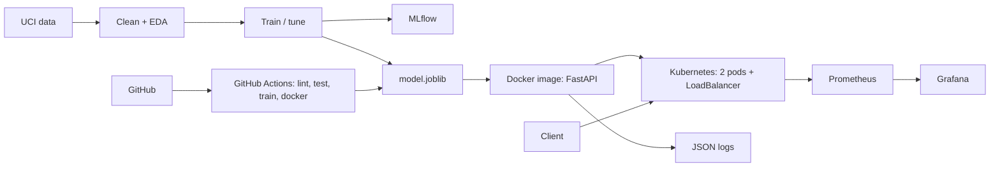

# Heart Disease Risk Prediction - MLOps Assignment 1 Report

**Course:** Machine Learning Operations (MLOps) AIMLCZG523  |  **Student:** [NAME] - [ID]  |  **Date:** [DATE]

**Code repository:** [https://github.com/USERNAME/REPO]
**Demo video:** [LINK]
**Deployed API (local):** `http://localhost:8080/predict` (Kubernetes LoadBalancer) - access instructions in Section 9

> Fill every **[FILL]** marker with your own numbers/observations after running the pipeline, replace the
> screenshot placeholders, then export to PDF (VS Code "Markdown PDF" extension, or
> `pandoc docs/REPORT.md -o report.pdf`). Aim for about 10 pages. Write the observations in your own words.

---

## 1. Introduction

The goal is a classifier that predicts the presence of heart disease from patient health data, delivered
as a reproducible, tested, containerised and monitored API. The work covers the full MLOps lifecycle:
data acquisition, EDA, model development, experiment tracking, packaging, CI/CD, containerisation,
Kubernetes deployment and monitoring - all on a local machine (no cloud subscription).

**Tech stack:** Python 3.11, pandas, scikit-learn, MLflow, FastAPI, Docker, Kubernetes (Docker Desktop /
Minikube), Prometheus, Grafana, GitHub Actions, pytest, flake8.

## 2. Setup and installation

```bash
git clone [REPO URL] && cd [REPO]
python -m venv .venv && source .venv/bin/activate
pip install -r requirements.txt
python scripts/download_data.py
python -m src.eda && python -m src.train
python -m pytest
```
Docker / Kubernetes / monitoring commands are in the README (Sections 7-9).

## 3. Data acquisition and EDA

**Dataset:** UCI Heart Disease, Cleveland subset - 303 patients, 13 predictors + target.
`scripts/download_data.py` downloads `processed.cleveland.data` from the UCI repository (with a zip-archive
fallback and a `--from-file` option) and writes `data/raw/` and `data/processed/`.

| Feature | Description |
|---|---|
| age, sex | Age (years), sex (1 = male) |
| cp | Chest pain type (1-4) |
| trestbps, chol | Resting blood pressure, serum cholesterol |
| fbs | Fasting blood sugar > 120 mg/dl |
| restecg | Resting ECG result (0-2) |
| thalach | Maximum heart rate achieved |
| exang | Exercise induced angina |
| oldpeak, slope | ST depression and slope of peak exercise ST segment |
| ca | Number of major vessels (0-3) coloured by fluoroscopy |
| thal | Thalassemia (3 normal, 6 fixed, 7 reversible defect) |
| target | Original 0-4 severity, binarised: 0 = no disease, 1 = disease |

### 3.1 Cleaning

* `?` markers converted to NaN; [FILL: 6] missing values found (`ca`: [FILL], `thal`: [FILL]).
* Duplicates removed: [FILL]. Target binarised (values 1-4 -> 1).
* Missing values imputed (median numeric / mode categorical) for the stored clean CSV; the model
  pipeline *also* contains imputers fitted on training folds only, so inference is robust to missing values.


### 3.2 Class balance


[FILL: e.g. "The classes are roughly balanced (X % vs Y %), so accuracy is meaningful, but we still
monitor recall because missing a sick patient is costlier than a false alarm."]

### 3.3 Distributions and correlations


**Key observations:** [FILL - e.g. which features separate the classes most (thalach, oldpeak, cp, ca, thal,
exang), whether any features are strongly collinear, outliers in `chol`/`trestbps`, age distribution.]

## 4. Feature engineering and modelling

### 4.1 Preprocessing pipeline

One `ColumnTransformer` (`src/features.py`) is part of the model `Pipeline`:

* **Numeric** (age, trestbps, chol, thalach, oldpeak, ca): median imputation -> `StandardScaler`.
* **Categorical** (sex, cp, fbs, restecg, exang, slope, thal): most-frequent imputation -> `OneHotEncoder(handle_unknown="ignore")`.

Because preprocessing sits inside the pipeline, cross-validation never leaks validation statistics and the
exact same transforms run at inference time - the saved artifact accepts raw feature values.

### 4.2 Models, tuning and evaluation protocol

| Model | Why | Hyper-parameters searched |
|---|---|---|
| Logistic Regression | Interpretable, strong baseline for small tabular data | C in {0.01 ... 100}, class_weight |
| Random Forest | Non-linear interactions, robust to scale | n_estimators, max_depth, min_samples_leaf |
| Gradient Boosting | Often best on tabular data | n_estimators, learning_rate, max_depth |

* 80/20 stratified train/test split (`random_state=42`); test set untouched until final evaluation.
* `GridSearchCV` with 5-fold `StratifiedKFold`; refit on **ROC-AUC**; accuracy, precision, recall, F1 tracked.
* **Model selection uses CV ROC-AUC only** (never the test set). CV scores of the tuned configuration are
  slightly optimistic because the same folds picked the hyper-parameters; the hold-out test set gives the unbiased estimate.

### 4.3 Results

[FILL: paste `reports/model_comparison.md`]

| Model | CV acc | CV prec | CV recall | CV ROC-AUC | Test acc | Test ROC-AUC |
|---|---|---|---|---|---|---|
| logistic_regression | [FILL] | [FILL] | [FILL] | [FILL] | [FILL] | [FILL] |
| random_forest | [FILL] | [FILL] | [FILL] | [FILL] | [FILL] | [FILL] |
| gradient_boosting | [FILL] | [FILL] | [FILL] | [FILL] | [FILL] | [FILL] |


**Selected model:** [FILL] - [FILL: justification, e.g. highest CV ROC-AUC, comparable recall, stability
(low CV std), interpretability trade-off.]
**Limitations:** small dataset (~300 rows) -> wide confidence intervals; single hospital (Cleveland) so
generalisation to other populations is untested; this is a learning project, not a medical device.

## 5. Experiment tracking (MLflow)

Every training run logs to a local SQLite-backed MLflow store (`mlflow.db`, artifacts in `mlruns/`):
a parent run `training-session` (dataset sizes, CV settings, git commit, selected model) with one nested run
per model containing:

* **Parameters:** best hyper-parameters, search-space size.
* **Metrics:** `cv_<metric>_mean`, `cv_<metric>_std`, `test_<metric>` for accuracy, precision, recall, F1, ROC-AUC.
* **Artifacts:** confusion matrix, ROC curve, feature importance, `cv_results.csv`, classification report,
  and the sklearn model (with signature and input example).


[FILL: summary of what you learned from comparing runs, e.g. effect of `class_weight`, tree depth, learning rate.]

## 6. Model packaging and reproducibility

* `models/model.joblib` - full sklearn `Pipeline` (preprocessing + estimator); `models/model_metadata.json` -
  model name/version, feature list, best params, CV/test metrics, sklearn version, MLflow run id.
* The model is also stored in MLflow format in each run's `model/` artifact.
* `requirements.txt` (full) and `requirements-api.txt` (serving) pin exact versions; the **same sklearn version**
  is used for training and serving to avoid pickle incompatibilities.
* Fixed seeds everywhere (`random_state=42`); a unit test asserts that two training runs give identical metrics.

## 7. Testing and CI/CD

**Unit tests** (`tests/`, pytest): data cleaning (target binarisation, missing values, '?' markers, duplicates,
schema validation), preprocessing (finite output, scaling, unseen categories), model training (artifacts,
metric ranges, reproducibility, raw-input prediction), API (health, predict, validation errors, batch,
metrics endpoint, 503 without model) and MLflow logging. Tests use synthetic data so CI needs no network.

**GitHub Actions** (`.github/workflows/ci.yml`): `lint -> test -> train -> docker`. Any failing step stops the
pipeline; each job uploads artifacts (test + coverage reports, training log, MLflow runs, model, figures, container logs).


[FILL (optional): screenshot of a deliberately failing run showing that the pipeline fails with clear logs.]

## 8. Containerisation

`Dockerfile`: `python:3.11-slim`, only serving dependencies, non-root user, health check, Uvicorn.
Endpoints: `POST /predict` (JSON in -> prediction + confidence out), `POST /predict/batch`, `GET /health`,
`GET /model-info`, `GET /metrics`. Inputs are validated with pydantic (ranges and types) - invalid input returns HTTP 422.

```bash
docker build -t heart-disease-api:1.0.0 .
docker run -d --name heart-api -p 8000:8000 heart-disease-api:1.0.0
python scripts/smoke_test.py http://localhost:8000
```


## 9. Production-style deployment (local Kubernetes)

No cloud subscription was used; the image is deployed to a local Kubernetes cluster ([Docker Desktop / Minikube - FILL]).

| Manifest | Purpose |
|---|---|
| `k8s/deployment.yaml` | 2 replicas, rolling update (maxUnavailable 0), readiness + liveness probes, CPU/memory requests and limits, Prometheus scrape annotations |
| `k8s/service.yaml` | `LoadBalancer` Service on port 8080 |
| `k8s/ingress.yaml` | Optional NGINX Ingress (`heart.local`) |
| `k8s/hpa.yaml` | Optional autoscaling on CPU |
| `k8s/monitoring/*.yaml` | Prometheus (pod discovery + RBAC) and Grafana |

```bash
bash scripts/k8s_deploy.sh
python scripts/smoke_test.py http://localhost:8080
```
**Access instructions:** API at `http://localhost:8080/docs`, Grafana at `http://localhost:3000` (admin/admin).


## 10. Monitoring and logging

* **Logging:** every request produces a structured JSON log line (request id, method, path, status, latency, client);
  model load events and errors are logged too. Visible with `docker logs` / `kubectl logs`.
* **Metrics** (`/metrics`, Prometheus format): `api_requests_total{method,endpoint,status}`,
  `api_request_latency_seconds` (histogram), `model_predictions_total{label}`, `model_prediction_confidence`
  (histogram), `api_requests_in_progress`, `model_loaded`.
* **Prometheus** discovers the API pods through Kubernetes annotations; **Grafana** shows request rate, p95 latency,
  status codes, predictions per class, median confidence and number of healthy instances (auto-provisioned dashboard).
* `scripts/generate_traffic.py` produces load (including a few invalid requests) for the demo.


Monitoring ideas for a real deployment: input-drift checks (compare live feature distributions with the training
data), alerts on error rate / latency, and periodic re-training triggered by the CI pipeline.

## 11. Architecture




## 12. Conclusion and future work

[FILL: what worked, challenges (e.g. image visibility in local Kubernetes, sklearn version pinning), what you
would add: model registry + staged promotion, data/model drift detection, canary deployments, automated
retraining, Helm chart, authentication on the API.]

## Appendix - repository structure

See README.md. Code: [REPO URL].
